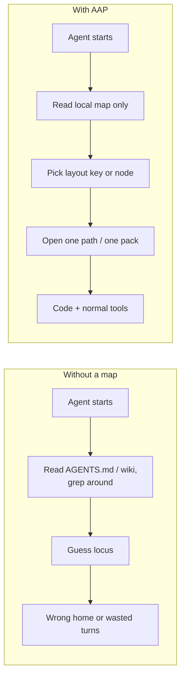
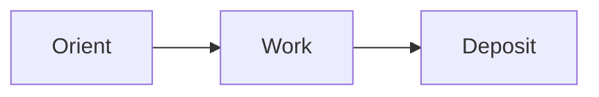
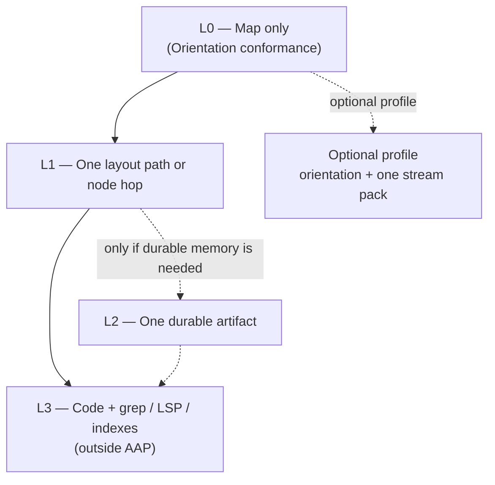
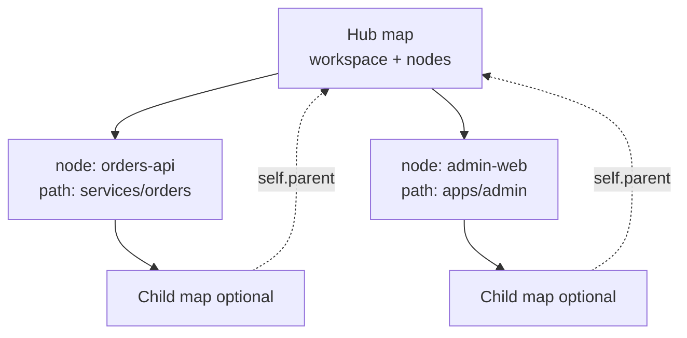
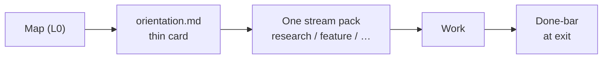
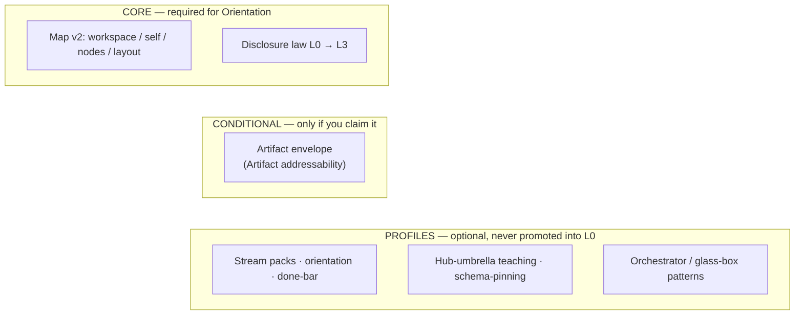

# Agent Artifact Protocol (AAP)

**Version:** 0.2.1-prototype  
**Status:** experimental prototype (docs + schema + validator)  
**License:** MIT  
**Git tag:** [`v0.2.1-prototype`](https://github.com/gitpash/agent-artifact-protocol/releases/tag/v0.2.1-prototype)  
(Documents omit the `v` prefix: `0.2.1-prototype`.)

> **AAP makes repository context addressable without requiring repository context to be loaded.**

AAP is a **runtime-agnostic filesystem convention**: a tiny map in the repo so agents (and humans) can **find the right place** without dumping the whole project into the prompt.

| AAP is | AAP is not |
|--------|------------|
| Sparse **map** + progressive disclosure | Context engine / RAG |
| Optional **profiles** in the cookbook | Agent harness or multi-agent runtime |
| Path **`access`** fences + optional node **`write`** role hints (coordination only) | Security sandbox or ACL |
| Pinned templates you copy once | Something fetched every agent turn |

The map is checked against **JSON Schema by a validator in CI**, so structure drift is caught by machine—not only by human review. That is a key difference from free-form orientation markdown.

### How this relates to

- **`AGENTS.md` / `CLAUDE.md`** — how to work vs where things are; orthogonal, can live side by side.
- **llms.txt-style indexes** — discovery lists of docs/URLs; AAP is a sparse layout/hop map, not a content catalog. Can coexist.
- **Repo-map style tools** — often generate or search structural overviews; AAP is a checked-in, schema-validated convention agents open first. Orthogonal.
- **Agent skills** — procedural how-to packs; AAP does not define skills and does not replace them.

---

## Use with your agent

**Give your LLM one link.** [`llms.txt`](./llms.txt) is written for an agent to read: what AAP is, what to open first, and the `access` rules.

```text
https://raw.githubusercontent.com/gitpash/agent-artifact-protocol/main/llms.txt
```

Paste that into any chat or agent session and ask it to explain AAP or to work in a repo that has an `.aap/map.yaml`. It points to the spec and schema only for when they are needed.

**Add a map to your own project with the `aap-map` skill.** The skill in [`skills/aap-map/`](./skills/aap-map/SKILL.md) is a single text file. It tells your agent how to look at a repository, write a minimal `.aap/map.yaml`, and say which parts it guessed (`# REVIEW:` comments). It does not interview you and it never overwrites an existing map. Say "ok" or ask for changes. Install it as a plain skill folder:

```bash
# Claude Code, user-level
git clone --depth 1 https://github.com/gitpash/agent-artifact-protocol.git /tmp/aap
cp -R /tmp/aap/skills/aap-map ~/.claude/skills/aap-map
```

Then ask your agent: *"use the aap-map skill to add an AAP map to this repo"*. Nothing to install and nothing is validated by a tool at this point. If you want machine checking later, for example in CI, see [`cookbook/ci-validation.md`](./cookbook/ci-validation.md).

Package layouts for skill installers and the Claude Code plugin marketplace (`.claude-plugin/`) are included in the repo, but the skill is not listed in any registry yet.

---

## What problem is this for?

Coding agents often fail on **orientation** and **context pollution**, not on “missing a wiki page.”

| Failure | What happens | Addressed by |
|---------|----------------|--------------|
| Wrong home | Edits land in the wrong package or “docs that look related” | **Core** (layout) |
| Preload bloat | Session opens constitutions, catalogs, every submodule map | **Core** (L0→L3) |
| No GPS | Multi-repo: path ≠ GitHub name; no clear hop | **Core** (nodes) |
| Fake confidence | “PR ready” with red CI / invented blockers | ***Profile*** ([done-bar](./cookbook/done-bar.md)) |

**AAP’s bet** (thesis, not a measured claim here): a sparse map + disclosure beats a bigger prompt. See [`MOTIVATION.md`](./MOTIVATION.md). How to run an honest local A/B: [`cookbook/measuring.md`](./cookbook/measuring.md).



---

## The protocol in three steps



1. **Orient** — read the local map (L0); pick a **layout** key or **node**.
2. **Work** — any harness, skills, MCP, or humans; AAP does **not** prescribe how work is done.
3. **Deposit** — durable results under layout **`artifacts`**; drafts under **`scratch`**; follow map rules (not random paths).

**Core Orientation conformance requires only step 1**; steps 2–3 are **convention**, not conformance MUST.

---

## How it works (Core)

### 1. One small map in *your* repo

Prefer `.aap/map.yaml` (also `map.yaml` or `docs/map.yaml`).

```yaml
version: 2
workspace:
  id: my-app
  description: What this checkout is
self:
  id: my-app
  kind: repository
  path: .
  # parent:                 # optional — see vocabulary
  #   id: my-hub
  #   path: ../..           # navigation only
layout:
  code: src/                       # string ≡ { path: src/, access: read-write }
  tests: tests/
  artifacts:
    - path: docs/artifacts/
      access: read-write           # same resourceRef shape; list allowed
  scratch: docs/scratch/
nodes:
  - id: orders-api
    kind: repository
    path: services/orders
    # access: read-only            # optional path fence on the hop
    # write: [domain]              # optional role hints — not an ACL
```

| Piece | Role |
|-------|------|
| **workspace / self** | What you opened |
| **self.parent** | Optional **one** navigation/container pointer (no ownership, auth, or recursive preload) |
| **layout** | Keys (`code`, `tests`, `artifacts`, `scratch`, …) → one or more **resourceRef**s |
| **nodes** | Direct **navigation hops** — not a dependency graph |
| **resourceRef** | Path string **or** `{ path, access?, description? }` |
| **`access`** | On a resourceRef or node hop: `read-only` \| `read-write` (default `read-write`). **Path coordination fence**, not OS/Git/IAM. When a layout key lists several refs, the durable place to write is the **first** whose `access` is not `read-only` (write-home — full rule in [SPEC](./SPEC.md)). |
| **`write`** | On a **node** only: optional string list of deployment-defined **role hints** (e.g. `domain`). Separate from `access`; does **not** grant filesystem permission ([SPEC](./SPEC.md)). |

Layout keys are **not** a natural-language task classifier. The human/agent chooses the task; AAP only says where `code` / `tests` live.

### 2. Progressive disclosure



| Level | What | When |
|-------|------|------|
| **L0** | Map only | Session start (**Orientation**) |
| **L1** | One path or node hop | After choosing a key or node |
| **L2** | One artifact | **Only if** durable memory is needed |
| **L3** | Normal engineering tools | Implementation |

**MUST NOT:** force-load this upstream repo, the full SPEC, or an artifact corpus just to begin work.

Full rules: [`SPEC.md`](./SPEC.md).

---

## 60-second start (brownfield)

1. Copy [`templates/minimal-map.yaml`](./templates/minimal-map.yaml) → `.aap/map.yaml` (see pin snippet below).
2. Edit `self`, `layout`, and `nodes` for **your** tree (keep it sparse).
3. Tell the agent: *read the local map first; do not preload AAP upstream docs.*
4. A/B a real task — **A: no map**, **B: map only**. If **B** does not help → **shrink the map**, do not add profiles.
5. Only then optional profiles (hub / one stream pack / done-bar).

**Pin** = which tag your copied templates came from. Nothing is fetched at agent runtime. Keep the pin visible in the map file:

```bash
git clone --depth 1 --branch v0.2.1-prototype \
  https://github.com/gitpash/agent-artifact-protocol.git /tmp/aap
mkdir -p .aap
{
  echo "# aap-pin: v0.2.1-prototype"
  echo "# source: https://github.com/gitpash/agent-artifact-protocol"
  cat /tmp/aap/templates/minimal-map.yaml
} > .aap/map.yaml
# edit .aap/map.yaml — work from YOUR repo, not /tmp/aap
```

YAML `#` comments do not affect schema validation. More detail: [`cookbook/schema-pinning.md`](./cookbook/schema-pinning.md), [`cookbook/brownfield-init.md`](./cookbook/brownfield-init.md).

---

## Multi-repo: hop, don’t preload



Nodes are **doors**, not “load every submodule into context.”  
[`cookbook/hub-umbrella.md`](./cookbook/hub-umbrella.md) · [`examples/hub-umbrella/`](./examples/hub-umbrella/).

---

## Optional profiles (not Core L0)

Incubator maturity table (status / based on / used by): [`cookbook/README.md`](./cookbook/README.md).

After map-only helps, you **may** add local procedure files (often gitignored):



| Profile | Cookbook |
|---------|----------|
| Stream packs (one task class per session) | [`stream-packs.md`](./cookbook/stream-packs.md) |
| Thin orientation + local index | [`local-bootstrap.md`](./cookbook/local-bootstrap.md) |
| Accept / done bar | [`done-bar.md`](./cookbook/done-bar.md) |
| Schema pin (no tip fetch) | [`schema-pinning.md`](./cookbook/schema-pinning.md) |
| CI validation (pinned schema on consumer maps) | [`ci-validation.md`](./cookbook/ci-validation.md) |
| Manager/worker session shape | [`orchestrator-session.md`](./cookbook/orchestrator-session.md) |
| Glass-box factory *pattern* (no CLI in this repo) | [`glass-box-factory.md`](./cookbook/glass-box-factory.md) |
| Measuring map value (A/B method only) | [`measuring.md`](./cookbook/measuring.md) |

Stubs: [`templates/orientation.md`](./templates/orientation.md), [`templates/stream-pack.yaml`](./templates/stream-pack.yaml).

---

## Core vs profile



| Also | |
|------|--|
| **Thin dispatcher** (`AGENTS.md`-style bootstrap) | Profile / runtime policy — not Core MUST |
| **Multi-agent “teams”** | One possible impl of orchestrator shape — not required |
| **Default session posture** | **Runtime recommendation, not a Core MUST:** until the user/runtime **explicitly** enables writes, prefer **read/orient only**. AAP cannot enforce this; sandboxes and Git permissions do. See [SPEC](./SPEC.md). |

Field definitions for **`access`** / **`write`**: [How it works §1](#1-one-small-map-in-your-repo).

---

## Vocabulary and conformance

| Term | Meaning |
|------|---------|
| **Map** | Sparse description of the opened workspace |
| **Node** | Direct hop to a related repo/product |
| **self.parent** | Optional single navigation/container pointer ([SPEC](./SPEC.md)) |
| **Layout key** | `code`, `tests`, `artifacts`, `scratch`, … → resourceRef(s) |
| **resourceRef**, **`access`**, **`write`** | See [How it works §1](#1-one-small-map-in-your-repo) (canonical) |
| **Artifact** | Optional durable note (envelope when claiming addressability) |
| **Profile** | Optional cookbook elaboration — never mandatory L0 |

| Conformance label | Means |
|-------------------|--------|
| **Orientation** | Discoverable sparse map; layout-based discovery possible |
| **Artifact** | Envelope field set when claiming addressability |
| **Topology** | Nodes are direct hops; listed paths are meant to resolve in the checkout |
| **Disclosure profile** *(optional)* | Streams / accept / thin orientation — not required for Orientation |

```bash
pip install pyyaml jsonschema
python scripts/validate.py
```

This is a **convention + schemas**, not a complete cross-file protocol suite.

---

## What’s in this repository

```text
README.md SPEC.md MOTIVATION.md CONTRIBUTING.md CHANGELOG.md llms.txt
skills/aap-map/   # portable agent skill (one SKILL.md)
.claude-plugin/   # plugin + marketplace manifests (not published)
schemas/          # Map v2 JSON Schema
legacy/v1/        # historical zones map
templates/        # minimal-map, orientation, stream-pack, artifacts
examples/         # single-repo, shell, hub-umbrella, meta-repo, stream-packs, invalid
cookbook/         # optional profiles + patterns
scripts/validate.py
```

**Intentionally absent:** product adoption guides, pilot dashboards, runtime adapters, factory/conductor CLI, mandatory multi-agent harnesses.  
See [`cookbook/what-not-to-copy.md`](./cookbook/what-not-to-copy.md). For init-tooling rules if you build any, see [`CONTRIBUTING.md`](./CONTRIBUTING.md).

---

## Status

**`0.2.1-prototype`** = experimental Map v2 Core (schema + validator) **plus** a dogfood-informed cookbook. Aimed at multi-repo pilots; **not** production infrastructure or a finished interoperability standard. Profiles do not make Core stable.

Map v2 rules come from the `0.2.0-draft` lineage; this tag adds prototype **docs** on that Core. **Schema unchanged** relative to that lineage; optional fields such as `self.parent`, `access`, and node `write` already exist in Map v2 (they are not newly required). v1: `legacy/v1/`.

Upstream is pinned by **tag/commit** into your repo; L0 stays the **local** map only (see 60-second start). Tag `v0.2.1-prototype` includes `templates/minimal-map.yaml`.

Feedback: map size, layout-key granularity, cross-runtime use without preload, whether Core is still too large, whether profiles stay optional in practice.

[`CONTRIBUTING.md`](./CONTRIBUTING.md) · [`CHANGELOG.md`](./CHANGELOG.md) · Issues/PRs welcome; keep L0 small.
