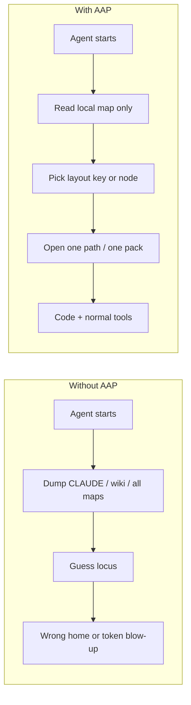
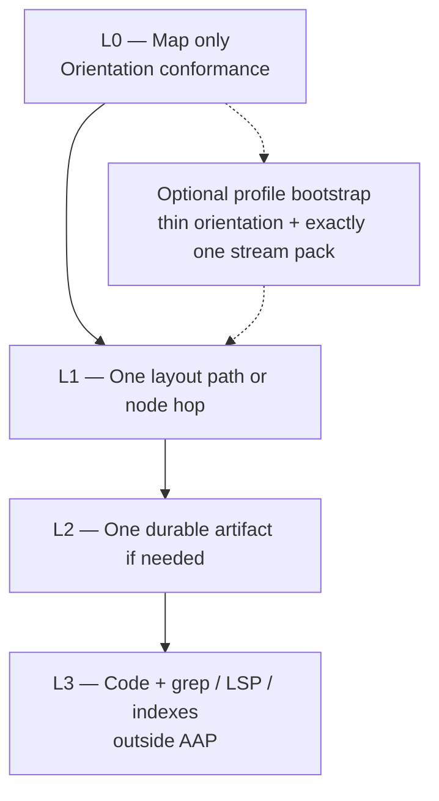
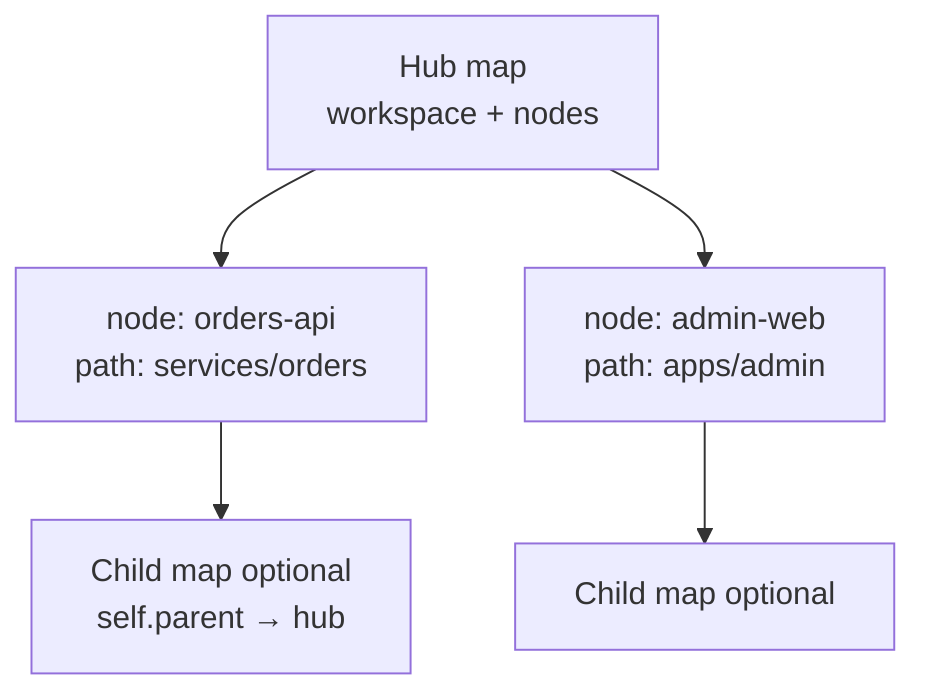
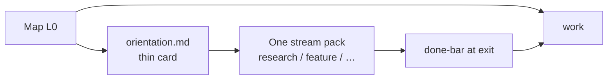
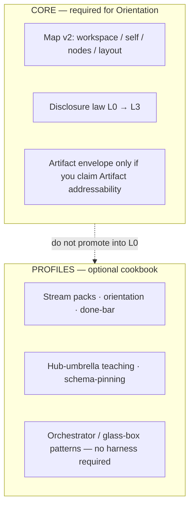
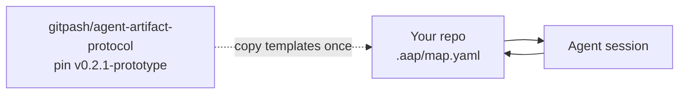

# Agent Artifact Protocol (AAP)

**Version:** 0.2.1-prototype  
**Status:** experimental Map v2 Core + dogfood-informed **optional** profiles (working-prototype **docs**)  
**License:** MIT  
**Git tag:** [`v0.2.1-prototype`](https://github.com/gitpash/agent-artifact-protocol/releases/tag/v0.2.1-prototype)  
**Documents omit the `v` prefix** (`0.2.1-prototype`).

> **AAP makes repository context addressable without requiring repository context to be loaded.**

AAP is a **runtime-agnostic filesystem convention**: a tiny map in the repo so agents (and humans) can **find the right place** without dumping CLAUDE/SPEC/wiki into the prompt.

It is **not** a context engine, RAG stack, agent harness, security sandbox, or mandatory preload pack.

---

## What problem is this for?

Coding agents waste turns on **orientation failure** and **context pollution**:

| Failure | What happens |
|---------|----------------|
| Wrong home | Edits land in the wrong package, service, or “docs that look related” |
| Preload bloat | Session starts by reading constitutions, full catalogs, every submodule map |
| No GPS | Multi-repo / monorepo: path ≠ GitHub name; nobody knows the hop |
| Fake confidence | “PR ready” with red CI or blockers invented without evidence |

AAP’s bet: **a sparse map + progressive disclosure** beats a bigger prompt.



---

## How it works (Core)

### 1. One small map in *your* repo

Prefer `.aap/map.yaml` (also `map.yaml` or `docs/map.yaml`).

```yaml
version: 2
workspace:
  id: my-app
  description: What this checkout is
self:
  id: my-app
  kind: repository
  path: .
layout:
  code: src/
  tests: tests/
  artifacts: docs/artifacts/    # optional durable notes
  scratch: docs/scratch/        # optional throwaway notes
nodes: []                         # or direct hops to related repos
```

| Piece | Role |
|-------|------|
| **workspace / self** | What you opened |
| **layout** | Vocabulary keys (`code`, `tests`, `artifacts`, `scratch`, …) → directories |
| **nodes** | Direct **navigation hops** (related repos/products) — not a dependency graph |
| **resourceRef** | Path string or `{ path, access?, description? }` (`access: read-only` = coordination fence, not ACL) |

### 2. Progressive disclosure (do not load the universe)



| Level | What | When |
|-------|------|------|
| **L0** | Map only | Session start |
| **L1** | Targeted path / layout index | After choosing a key or node |
| **L2** | One artifact | Durable memory needed |
| **L3** | Normal engineering tools | Implementation |

**MUST NOT:** force-load this upstream repo, the full SPEC, or an artifact corpus just to begin work.

### 3. Multi-repo: hop, don’t preload



Nodes are **doors**, not “git clone everything into context.”  
See [`cookbook/hub-umbrella.md`](./cookbook/hub-umbrella.md) and [`examples/hub-umbrella/`](./examples/hub-umbrella/).

### 4. Optional profiles (not Core L0)

After map-only helps, you **may** add local procedure files (often gitignored):



| Profile | Cookbook |
|---------|----------|
| Stream packs (one task class per session) | [`stream-packs.md`](./cookbook/stream-packs.md) |
| Thin orientation + local index | [`local-bootstrap.md`](./cookbook/local-bootstrap.md) |
| Accept / done bar | [`done-bar.md`](./cookbook/done-bar.md) |
| Schema pin (no tip fetch) | [`schema-pinning.md`](./cookbook/schema-pinning.md) |
| Manager/worker session shape | [`orchestrator-session.md`](./cookbook/orchestrator-session.md) |
| Glass-box factory *pattern* (no CLI here) | [`glass-box-factory.md`](./cookbook/glass-box-factory.md) |

Templates: [`templates/orientation.md`](./templates/orientation.md), [`templates/stream-pack.yaml`](./templates/stream-pack.yaml).

---

## 60-second start (brownfield)

1. Copy [`templates/minimal-map.yaml`](./templates/minimal-map.yaml) → `.aap/map.yaml` (or `map.yaml` / `docs/map.yaml`).
2. Edit `self`, `layout`, and `nodes` for **your** tree (keep it sparse).
3. Tell the agent: *read the local map first; do not preload AAP upstream docs.*
4. A/B a real task: **no map** vs **map only**. If map doesn’t help → **shrink**, don’t add profiles.
5. Only then optional profiles (hub / streams / done-bar).

Pin this protocol by **tag or commit** (never floating `main` as a live fetch):

```bash
git clone --depth 1 --branch v0.2.1-prototype \
  https://github.com/gitpash/agent-artifact-protocol.git /tmp/aap
mkdir -p .aap && cp /tmp/aap/templates/minimal-map.yaml .aap/map.yaml
# edit .aap/map.yaml — then work from YOUR repo, not /tmp/aap
```

Details: [`cookbook/schema-pinning.md`](./cookbook/schema-pinning.md), [`cookbook/brownfield-init.md`](./cookbook/brownfield-init.md).

Init tooling (if you add any) MUST be explicit, additive, dry-run capable, human-reviewed — **never** silent overwrite of existing files.

---

## Core vs profile (don’t mix them up)



| Layer | Required for Orientation? |
|-------|---------------------------|
| Map v2 + disclosure law | **Yes** |
| Artifact envelope | Only if claiming Artifact addressability |
| Stream packs / accept bars / orientation cards | **No** |
| Thin runtime dispatcher (`AGENTS.md`-style) | **No** |
| Multi-agent “teams” runtimes | **No** (one way to implement orchestrator shape) |

**`write` / `access` are coordination hints, not security.** Real enforcement = Git permissions, CODEOWNERS, host policy, sandbox.

---

## Core vocabulary (short)

| Term | Meaning |
|------|---------|
| **Map** | Sparse description of the opened workspace |
| **Node** | Direct hop to a related repo/product |
| **Layout key** | `code`, `tests`, `artifacts`, `scratch`, … → path(s); extensions allowed |
| **resourceRef** | Path string or `{ path, access?, description? }` (default access `read-write`) |
| **Artifact** | Optional durable note (historical envelope separately versioned) |
| **Profile** | Optional named elaboration — never mandatory L0 |

Layout keys are **not** a natural-language task classifier. “Modernize the API” is chosen by the human/agent; AAP only says where `code` / `tests` live.

Full rules: [`SPEC.md`](./SPEC.md).

---

## Conformance (lightweight)

| Label | Means |
|-------|--------|
| **Orientation** | Discoverable sparse map; layout-based discovery possible |
| **Artifact** | Durable notes use the envelope field set when claiming addressability |
| **Topology** | Honest direct nodes and paths |
| **Disclosure profile** *(optional)* | Streams / accept / thin orientation — **not** required for Orientation |

```bash
pip install pyyaml jsonschema
python scripts/validate.py
```

---

## What’s in this repository

```text
README.md                 ← you are here
SPEC.md                   # Map v2 Core (on demand — not L0)
MOTIVATION.md
CONTRIBUTING.md
CHANGELOG.md
schemas/                  # Map v2 JSON Schema
legacy/v1/                # historical zones map
templates/                # minimal-map, orientation, stream-pack, artifacts
examples/                 # single-repo, shell, hub-umbrella, stream-packs, invalid
cookbook/                 # optional profiles + patterns
scripts/validate.py
```

**Intentionally absent:** product adoption guides, pilot dashboards, runtime adapters, factory/conductor CLI, mandatory multi-agent harnesses.  
See [`cookbook/what-not-to-copy.md`](./cookbook/what-not-to-copy.md).

---

## Upstream vs your product repo

| This repo | Your repo |
|-----------|-----------|
| Spec + templates + examples | **Pinned** tag/commit (e.g. `v0.2.1-prototype`) |
| Evolves via tags | Local map + optional local profiles |
| Not fetched every agent turn | L0 = **local** map only |



---

## Status

**`0.2.1-prototype`** = experimental Map v2 Core **plus** a dogfood-informed **cookbook prototype**. Useful in multi-repo pilots. **Not** production infrastructure or a finished interoperability standard. Profiles do not make Core “stable.”

Map v2 landed in the `0.2.0-draft` lineage; this tag documents optional profiles on **that same Core** (schema required fields unchanged). v1 lives under `legacy/v1/`.

Feedback welcome: map size, layout-key granularity, cross-runtime use without preload, whether Core is still too large, whether profiles stay optional in practice.

[`CONTRIBUTING.md`](./CONTRIBUTING.md) · [`CHANGELOG.md`](./CHANGELOG.md) · Issues/PRs welcome; prefer changes that keep L0 small.
