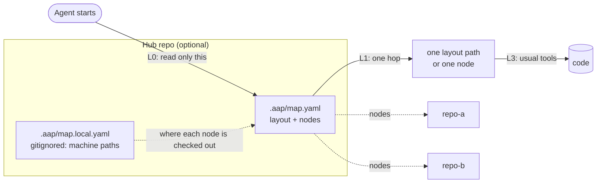

# Agent Artifact Protocol (AAP)

**A short map in your repo that tells coding agents where things live, so they open the right place instead of loading everything.**



The map is plain YAML and a convention, not a tool. Your normal search (grep, LSP, MCP) still does the finding.

## Quick start

```bash
npx skills add gitpash/agent-artifact-protocol
```

Claude Code plugin: `/plugin marketplace add gitpash/agent-artifact-protocol`, then `/plugin install aap@agent-artifact-protocol`.

Then, inside the repository you want to map, tell your agent:

> Use the aap-map skill to add an AAP map to this repo.

It writes `.aap/map.yaml` and marks guesses with `# REVIEW:`. Fix or delete those, commit the file, and add one line to `AGENTS.md` or `CLAUDE.md` saying to read the map first. It never overwrites an existing map.

No install? Give your LLM [`llms.txt`](https://raw.githubusercontent.com/gitpash/agent-artifact-protocol/main/llms.txt) and ask it to work in a repo that has a map.

## A minimal map

```yaml
version: 2
workspace: { id: my-app, description: "What this repository is, one line." }
self: { id: my-app, kind: repository, path: . }
layout:
  code: src/
  tests: tests/
nodes:
  - id: orders-api
    kind: repository
    description: "Owns the orders contract this app consumes."
    locator: { repo: example/orders-api }
    access: read-only
```

`layout` maps an intent to a path here. `nodes` are direct hops to other repositories (most repos use `nodes: []`). Machine paths for nodes go in the gitignored `.aap/map.local.yaml`, never in the shared map. More: [`examples/`](./examples/), [`templates/minimal-map.yaml`](./templates/minimal-map.yaml).

## What it is not

Not a retrieval engine, not an agent framework, not a security boundary (`access` is a note, enforcement stays with Git permissions and sandboxes), and not a replacement for `AGENTS.md`: those say how to work, the map says where things are.

## Going further

- [`SPEC.md`](./SPEC.md) and [`schemas/`](./schemas/): the normative spec and JSON Schema.
- [`cookbook/`](./cookbook/): optional recipes. For a hub of many repos: [home repo](./cookbook/home-repo.md), [workspace tools](./cookbook/workspace-tools.md) and [node state](./cookbook/node-state.md). Worked example: [`examples/personal-hub/`](./examples/personal-hub/).
- [`docs/motivation.md`](./docs/motivation.md), [`docs/skill-tests.md`](./docs/skill-tests.md), [`CONTRIBUTING.md`](./CONTRIBUTING.md), [`CHANGELOG.md`](./CHANGELOG.md).
- This repo's own map: [`.aap/map.yaml`](./.aap/map.yaml). Optional CI check: [`cookbook/ci-validation.md`](./cookbook/ci-validation.md).

## Status, honestly

Version 0.3.0, experimental. The Map v2 schema has not changed since 0.2.0, but the convention has been used on few repositories, mostly by its author. The thesis that a sparse map beats a bigger prompt is unproven here; [`cookbook/measuring.md`](./cookbook/measuring.md) shows how to test it on your own work. If a map does not help, shrink it before adding anything. You do not need AAP for a small repo with a good README. Feedback as issues is welcome.

MIT, see [`LICENSE`](./LICENSE).
