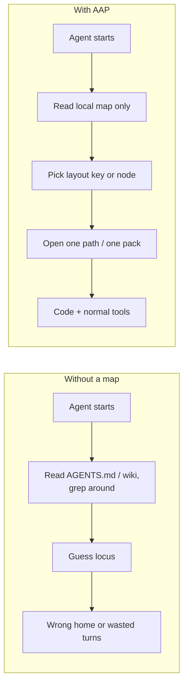
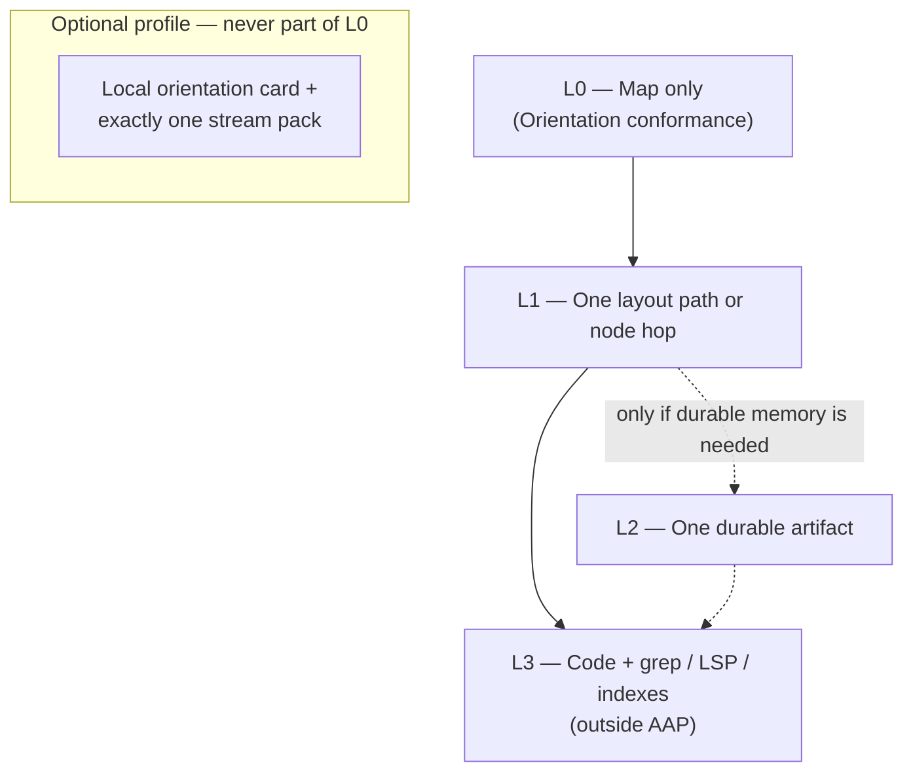
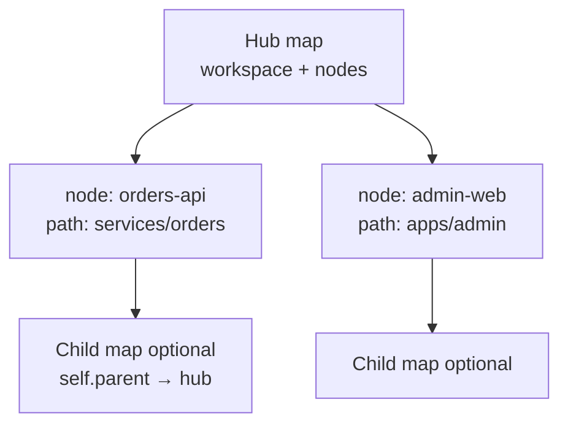
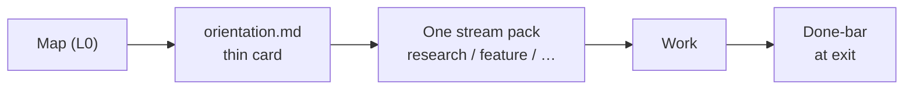
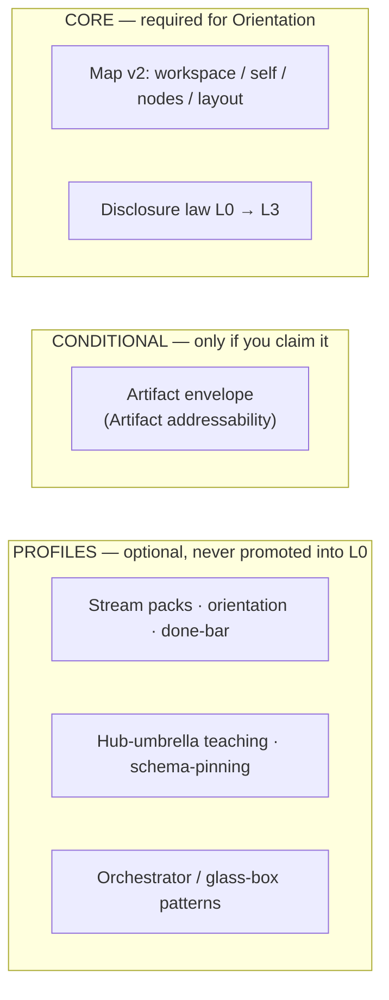

# Agent Artifact Protocol (AAP)

**Version:** 0.2.1-prototype  
**Status:** experimental · docs-only prototype  
**License:** MIT  
**Git tag:** [`v0.2.1-prototype`](https://github.com/gitpash/agent-artifact-protocol/releases/tag/v0.2.1-prototype)  
(Documents omit the `v` prefix: `0.2.1-prototype`.)

> **AAP makes repository context addressable without requiring repository context to be loaded.**

AAP is a **runtime-agnostic filesystem convention**: a tiny map in the repo so agents (and humans) can **find the right place** without dumping the whole project into the prompt.

| AAP is | AAP is not |
|--------|------------|
| Sparse **map** + progressive disclosure | Context engine / RAG |
| Optional **profiles** in the cookbook | Agent harness or multi-agent runtime |
| Coordination hints (`write` / `access`) | Security sandbox or ACL |
| Pinned templates you copy once | Something fetched every agent turn |

**AAP does not replace `AGENTS.md` / `CLAUDE.md`:** those say *how to work*; the map says *where things are*. They can live side by side.

---

## What problem is this for?

Coding agents often fail on **orientation** and **context pollution**, not on “missing a wiki page.”

| Failure | What happens | Addressed by |
|---------|----------------|--------------|
| Wrong home | Edits land in the wrong package or “docs that look related” | **Core** (layout) |
| Preload bloat | Session opens constitutions, catalogs, every submodule map | **Core** (L0→L3) |
| No GPS | Multi-repo: path ≠ GitHub name; no clear hop | **Core** (nodes) |
| Fake confidence | “PR ready” with red CI / invented blockers | ***Profile*** ([done-bar](./cookbook/done-bar.md)) |

**AAP’s bet** (thesis, not a measured claim here): a sparse map + disclosure beats a bigger prompt. See [`MOTIVATION.md`](./MOTIVATION.md); validate with a local A/B (below) before you expand.



---

## How it works (Core)

### 1. One small map in *your* repo

Prefer `.aap/map.yaml` (also `map.yaml` or `docs/map.yaml`).

```yaml
version: 2
workspace:
  id: my-app
  description: What this checkout is
self:
  id: my-app
  kind: repository
  path: .
  # parent:                 # optional — see vocabulary
  #   id: my-hub
  #   path: ../..           # or map.path hop; navigation only
layout:
  code: src/
  tests: tests/
  artifacts: docs/artifacts/   # optional durable notes
  scratch: docs/scratch/       # optional throwaway notes
nodes: []                        # or direct hops to related repos
```

| Piece | Role |
|-------|------|
| **workspace / self** | What you opened |
| **self.parent** | Optional **one** navigation/container pointer (no ownership, auth, or recursive preload) |
| **layout** | Keys (`code`, `tests`, `artifacts`, `scratch`, …) → directories |
| **nodes** | Direct **navigation hops** — not a dependency graph |
| **resourceRef** | Path string or `{ path, access?, description? }` (`access: read-only` = coordination fence, **not** ACL) |

Layout keys are **not** a natural-language task classifier. The human/agent chooses the task; AAP only says where `code` / `tests` live.

### 2. Progressive disclosure



| Level | What | When |
|-------|------|------|
| **L0** | Map only | Session start (**Orientation**) |
| **L1** | One path or node hop | After choosing a key or node |
| **L2** | One artifact | **Only if** durable memory is needed |
| **L3** | Normal engineering tools | Implementation |

**MUST NOT:** force-load this upstream repo, the full SPEC, or an artifact corpus just to begin work.

Full rules: [`SPEC.md`](./SPEC.md).

---

## 60-second start (brownfield)

1. Copy [`templates/minimal-map.yaml`](./templates/minimal-map.yaml) → `.aap/map.yaml`.
2. Edit `self`, `layout`, and `nodes` for **your** tree (keep it sparse).
3. Tell the agent: *read the local map first; do not preload AAP upstream docs.*
4. A/B a real task: **no map** vs **map only**. If B does not help → **shrink the map**, do not add profiles.
5. Only then optional profiles (hub / one stream pack / done-bar).

**Pin** = which tag your copied templates came from. Nothing is fetched at agent runtime.

```bash
git clone --depth 1 --branch v0.2.1-prototype \
  https://github.com/gitpash/agent-artifact-protocol.git /tmp/aap
mkdir -p .aap && cp /tmp/aap/templates/minimal-map.yaml .aap/map.yaml
# edit .aap/map.yaml — work from YOUR repo, not /tmp/aap
```

More detail: [`cookbook/schema-pinning.md`](./cookbook/schema-pinning.md), [`cookbook/brownfield-init.md`](./cookbook/brownfield-init.md).

---

## Multi-repo: hop, don’t preload



Nodes are **doors**, not “load every submodule into context.”  
[`cookbook/hub-umbrella.md`](./cookbook/hub-umbrella.md) · [`examples/hub-umbrella/`](./examples/hub-umbrella/).

---

## Optional profiles (not Core L0)

After map-only helps, you **may** add local procedure files (often gitignored):



| Profile | Cookbook |
|---------|----------|
| Stream packs (one task class per session) | [`stream-packs.md`](./cookbook/stream-packs.md) |
| Thin orientation + local index | [`local-bootstrap.md`](./cookbook/local-bootstrap.md) |
| Accept / done bar | [`done-bar.md`](./cookbook/done-bar.md) |
| Schema pin (no tip fetch) | [`schema-pinning.md`](./cookbook/schema-pinning.md) |
| Manager/worker session shape | [`orchestrator-session.md`](./cookbook/orchestrator-session.md) |
| Glass-box factory *pattern* (no CLI in this repo) | [`glass-box-factory.md`](./cookbook/glass-box-factory.md) |

Stubs: [`templates/orientation.md`](./templates/orientation.md), [`templates/stream-pack.yaml`](./templates/stream-pack.yaml).

---

## Core vs profile



| Also remember | |
|---------------|--|
| **`write` / `access`** | Coordination hints, **not** security. Enforcement = Git / CODEOWNERS / host / sandbox. |
| **Thin dispatcher** (`AGENTS.md`-style bootstrap) | Profile / runtime policy — not Core MUST. |
| **Multi-agent “teams”** | One possible impl of orchestrator shape — not required. |

Default with no explicit mutating mode: **read/orient only** (no write grant).

---

## Vocabulary and conformance

| Term | Meaning |
|------|---------|
| **Map** | Sparse description of the opened workspace |
| **Node** | Direct hop to a related repo/product |
| **self.parent** | Optional single navigation/container pointer (see SPEC) |
| **Layout key** | `code`, `tests`, `artifacts`, `scratch`, … → path(s) |
| **resourceRef** | Path string or `{ path, access?, description? }` |
| **Artifact** | Optional durable note (envelope when claiming addressability) |
| **Profile** | Optional cookbook elaboration — never mandatory L0 |

| Conformance label | Means |
|-------------------|--------|
| **Orientation** | Discoverable sparse map; layout-based discovery possible |
| **Artifact** | Envelope field set when claiming addressability |
| **Topology** | Honest direct nodes and paths |
| **Disclosure profile** *(optional)* | Streams / accept / thin orientation — not required for Orientation |

```bash
pip install pyyaml jsonschema
python scripts/validate.py
```

This is a **convention + schemas**, not a complete cross-file protocol suite.

---

## What’s in this repository

```text
README.md SPEC.md MOTIVATION.md CONTRIBUTING.md CHANGELOG.md
schemas/          # Map v2 JSON Schema
legacy/v1/        # historical zones map
templates/        # minimal-map, orientation, stream-pack, artifacts
examples/         # single-repo, shell, hub-umbrella, stream-packs, invalid
cookbook/         # optional profiles + patterns
scripts/validate.py
```

**Intentionally absent:** product adoption guides, pilot dashboards, runtime adapters, factory/conductor CLI, mandatory multi-agent harnesses.  
[`cookbook/what-not-to-copy.md`](./cookbook/what-not-to-copy.md).

Init tooling, if you add any elsewhere, MUST be explicit, additive, dry-run capable, and human-reviewed — never silent overwrite ([`CONTRIBUTING.md`](./CONTRIBUTING.md), [`SPEC.md`](./SPEC.md)).

---

## Upstream vs your product repo

| This repo | Your repo |
|-----------|-----------|
| Spec + templates + examples | **Pinned** tag/commit (e.g. `v0.2.1-prototype`) |
| Evolves via tags | Local map + optional local profiles |
| Not fetched every agent turn | L0 = **local** map only |

---

## Status

**`0.2.1-prototype`** = experimental Map v2 Core **plus** a dogfood-informed cookbook. Aimed at multi-repo pilots; **not** production infrastructure or a finished interoperability standard. Profiles do not make Core stable.

Map v2 rules come from the `0.2.0-draft` lineage; this tag adds prototype **docs** on that Core (required schema fields unchanged). v1: `legacy/v1/`.

Feedback: map size, layout-key granularity, cross-runtime use without preload, whether Core is still too large, whether profiles stay optional in practice.

[`CONTRIBUTING.md`](./CONTRIBUTING.md) · [`CHANGELOG.md`](./CHANGELOG.md) · Issues/PRs welcome; keep L0 small.
